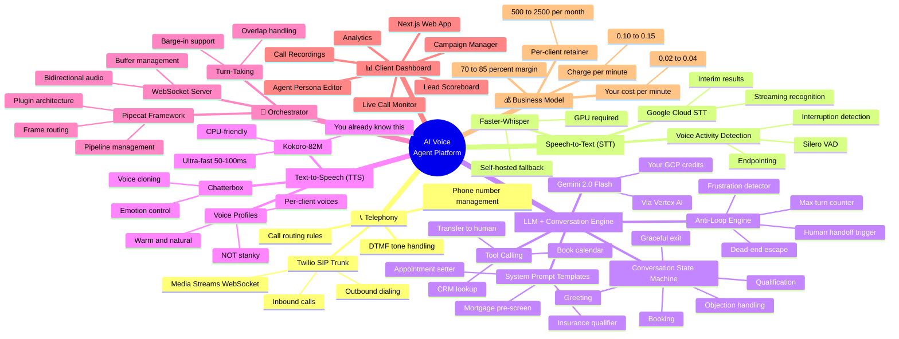
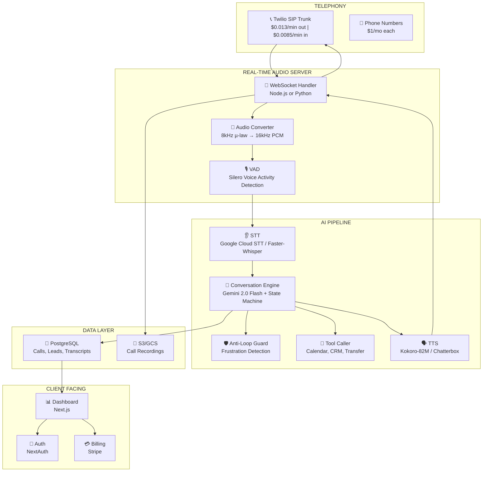
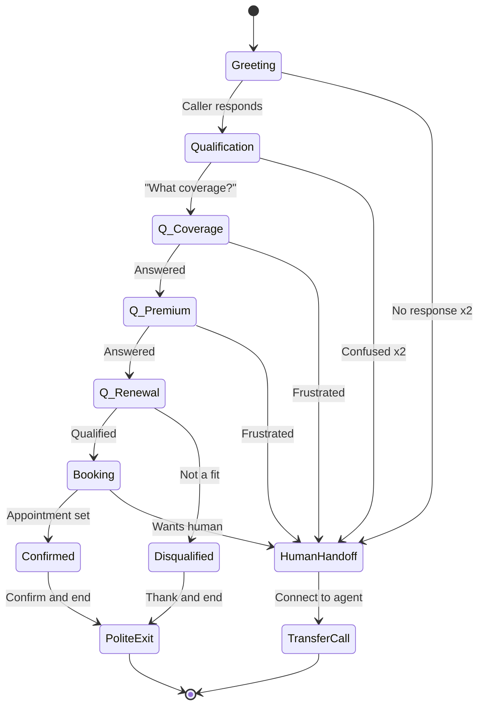

# 🏗️ AI Voice Agent Platform — Complete System Blueprint

> **Goal:** Own the entire stack. No third-party voice agent services. YOU are the company.  
> **Anti-goal:** No Marriott-style loops. No hostage situations. No stanky voices.

---

## 🗺️ Semantic Concept Map



---

## System Architecture



---

## Layer-by-Layer Breakdown

### Layer 1: Telephony — $0.013/min

**What:** Routes real phone calls between the outside world and your AI.

| Component | Technology | Cost |
|---|---|---|
| SIP Trunking | Twilio Programmable Voice | $0.013/min out, $0.0085/min in |
| Phone numbers | Twilio DIDs | $1/mo per number |
| Audio streaming | Twilio Media Streams API | Included |
| Outbound dialing | Twilio REST API | Per-minute |

**Key code path:**
```
Incoming call → Twilio webhook → Your server responds with TwiML
  → <Connect><Stream url="wss://yourserver.com/audio" /></Connect>
  → Bidirectional WebSocket opens → Raw audio flows both ways
```

**For outbound (AI calls THEM):**
```
Your server → Twilio REST API → Dial number
  → When connected → Open Media Stream → Same pipeline
```

---

### Layer 2: Speech-to-Text — $0.005/min (or $0 self-hosted)

**What:** Converts caller's voice into text in real-time.

| Option | Latency | Cost | When to Use |
|---|---|---|---|
| **Google Cloud STT** (streaming) | ~200ms | $0.006/min (or GCP credits) | **Phase 1 — use your $200 credits** |
| **Faster-Whisper** | ~300-500ms | $0 (GPU needed) | **Phase 3 — after you're profitable** |
| **Deepgram Nova-2** | ~200ms | $0.0043/min | Alternative to Google |

**Critical details:**
- Twilio sends **8kHz µ-law** encoded audio
- STT engines need **16kHz linear PCM**
- You MUST convert in real-time (use `audioop` in Python or `ffmpeg` bindings)
- Use **streaming recognition** — get words AS they're spoken, not after silence
- **Voice Activity Detection (Silero VAD)** — detect when caller STOPS talking before sending to LLM

---

### Layer 3: The Brain — $0.005/min

**What:** Understands what the caller said, decides what to do, generates a response.

**LLM:** Gemini 2.0 Flash via Vertex AI (your $200 GCP credits)

#### Conversation State Machine

This is what prevents the Marriott disaster. Every call follows a **defined flow** with **escape routes at every stage**:



#### Anti-Loop Engine (The Marriott Fix)

| Protection | How It Works | Trigger |
|---|---|---|
| **Max turn counter** | Track total exchanges. Force exit after 15 turns max | `turn_count >= 15` |
| **Repeat detector** | If AI says the same thing 2x, change approach or escalate | `response_similarity > 0.85` |
| **Dead-end detector** | If conversation hasn't progressed state in 3 turns, escalate | `same_state_count >= 3` |
| **Frustration detector** | Detect anger, profanity, raised voice in transcription | Keywords + sentiment analysis |
| **Silence handler** | If caller silent for 10s, prompt once. Silent again = polite end | `silence_duration > 10s` |
| **Explicit escape** | Caller says "agent", "human", "representative", "manager" → instant transfer | Keyword matching |
| **Time limit** | Hard cap: 5 minutes per call. Wrap up at 4 min | `call_duration >= 240s` |

**Implementation in the system prompt:**
```
CRITICAL RULES:
1. NEVER repeat the same question twice. If they didn't answer, 
   rephrase OR move on OR ask if they'd prefer to speak with a person.
2. If the caller sounds frustrated, angry, or says any profanity, 
   immediately say: "I understand, let me connect you with a person 
   who can help. One moment please." Then transfer.
3. If you've asked 3 questions and gotten nowhere, say: 
   "I want to make sure I'm helpful. Would you prefer I connect 
   you with one of our agents directly?"
4. NEVER keep someone on the line longer than 4 minutes. At 4 min:
   "I appreciate your time. Let me have an agent follow up with 
   you directly. They'll call you within the hour."
5. You are NOT a gatekeeper. You are a HELPER. If in doubt, transfer.
```

**Frustration detection (code-level):**
```python
FRUSTRATION_SIGNALS = {
    "keywords": ["fuck", "shit", "damn", "hell", "stupid", "idiot", 
                 "real person", "human", "agent", "manager", "supervisor",
                 "this is ridiculous", "are you a robot", "stop", 
                 "I already said", "I just told you", "listen"],
    "patterns": [
        r"i (already|just) (said|told)",  # Repetition frustration 
        r"(can|let) .* (talk|speak) .* (human|person|agent|someone)",
        r"(what|how) (many|much) (more|longer)",  # Time frustration
    ]
}

def detect_frustration(transcript: str, turn_count: int) -> bool:
    # Check keywords
    lower = transcript.lower()
    if any(kw in lower for kw in FRUSTRATION_SIGNALS["keywords"]):
        return True
    # Check patterns
    if any(re.search(p, lower) for p in FRUSTRATION_SIGNALS["patterns"]):
        return True
    # High turn count = passive frustration
    if turn_count > 10:
        return True
    return False
```

#### Tool Calling (What Makes It Useful)

| Tool | What It Does | Integration |
|---|---|---|
| `book_appointment` | Schedules a meeting on the broker's calendar | Google Calendar API |
| `lookup_client` | Checks if caller is an existing client | CRM/Database query |
| `transfer_to_human` | Warm-transfers to a live agent | Twilio call transfer |
| `send_followup` | Sends email/SMS after the call | SendGrid/Twilio SMS |
| `log_lead` | Saves lead info to dashboard | PostgreSQL insert |

---

### Layer 4: Text-to-Speech — $0 (self-hosted)

**What:** Converts AI's text response into natural-sounding speech.

| Option | Latency | Quality | Voice Cloning | Verdict |
|---|---|---|---|---|
| **Chatterbox** | ~150-200ms | Excellent | ✅ Yes | **Starts here. Native 8kHz support.** |
| **Kokoro-82M** | 50-100ms | Good | ❌ | **Risk:** Generates 24kHz. Downsampling to 8kHz causes artifacts. |
| **Google Cloud TTS** | 100-200ms | Excellent | ❌ | Safe fallback (uses credits) |

**The "Marriott Risk" Validated:**
Marriott actually uses **NICE CXone + Five9**, not Kokoro. Their failure is **bad state management** (the loops) + generic enterprise TTS.
**However**, my research confirmed Kokoro-82M *does* degrade when downsampled to 8kHz (phone quality). It loses breath/emotion details and can sound robotic.

**Recommendation:**
1. **Start with Chatterbox** (MIT license). It's built for real-time and handles lower sample rates better.
2. **Fallback:** If Chatterbox is too complex to set up Day 1, use Google Cloud TTS (standard voices) just to get the pipeline working.
3. **Avoid Kokoro** for the telephony path unless you build a high-quality resampling filter (complex).

**Voice selection principle:** The voice is the PRODUCT. If it sounds like a robot, the caller hangs up in 3 seconds. Spend time here.

---

### Layer 5: Orchestration — Pipecat

**What:** The framework that connects all layers into a real-time pipeline.

**Pipecat pipeline example:**
```python
from pipecat.pipeline import Pipeline
from pipecat.transports.twilio import TwilioTransport
from pipecat.services.google import GoogleSTTService, GoogleTTSService
from pipecat.services.google import GoogleLLMService

pipeline = Pipeline([
    TwilioTransport(),          # Layer 1: Audio in/out
    GoogleSTTService(),          # Layer 2: Speech → Text
    ConversationEngine(),        # Layer 3: Brain + Anti-Loop
    GoogleTTSService(),          # Layer 4: Text → Speech
])

pipeline.run()
```

**Key orchestration features to build:**
| Feature | What It Does |
|---|---|
| **Barge-in / Interruption** | If caller talks while AI is speaking → stop TTS, listen |
| **Turn-taking** | Don't let AI and caller talk over each other |
| **Endpointing** | Detect when caller finished their sentence (not just paused) |
| **Concurrent calls** | Handle 10+ calls simultaneously |
| **Graceful degradation** | If STT/LLM/TTS fails → apologize + transfer to human |

---

### Layer 6: Client Dashboard — Next.js

**What:** Web app where brokers manage everything.

**MVP screens:**
| Screen | Purpose |
|---|---|
| `/campaigns` | Create campaign → upload CSV leads, set schedule, pick AI persona |
| `/calls` | Live + historical calls, play recordings, read transcripts |
| `/leads` | Qualified leads sorted by hot/warm/cold |
| `/agent` | Edit AI persona script, voice, qualifying questions |
| `/analytics` | Calls made, connection rate, qualification rate, cost |
| `/settings` | Account, billing (Stripe), integrations |

---

## Cost Per Minute Breakdown

| Component | Your Cost | Retell AI | Bland AI |
|---|---|---|---|
| Telephony | $0.013 | $0.02 | $0.02 |
| STT | $0.006 (GCP) → $0 (Whisper) | Included | Included |
| LLM | $0.005 (Gemini Flash) | $0.04-0.06 | Included |
| TTS | $0.00 (Kokoro) | $0.02-0.04 | Included |
| Platform | $0.00 (you own it) | $0.07 | $0.09 |
| **TOTAL** | **$0.02-0.04** | **$0.15-0.19** | **$0.11** |

**You charge $0.10-0.15/min → 70-85% profit margin**  
**Or flat retainer: $500-2,500/mo per client**

---

## Build Timeline

| Phase | Duration | Goal | Deliverable |
|---|---|---|---|
| **1. Proof of Concept** | 3-5 days | Call your Twilio number, talk to AI, it responds | Working inbound call agent |
| **2. Make It Smart** | 1-2 weeks | State machine, anti-loop, tool calling, outbound calls | Production-quality conversations |
| **3. Dashboard** | 1-2 weeks | Broker can log in, upload leads, monitor calls | Client-facing product |
| **4. Launch** | Ongoing | Sell, onboard, iterate | Revenue |

---

## Minimum Viable Stack (Phase 1)

```
Twilio ($1/mo number + ~$0.013/min)
    ↓ WebSocket (Media Streams)
Python Server (Pipecat)
    ↓
Google Cloud STT (your $200 credits)
    ↓
Gemini 2.0 Flash (your $200 credits)
    ↓
Kokoro-82M TTS (self-hosted, free)
    ↓ WebSocket
Twilio → Caller hears response
```

**Startup cost: ~$1** (one phone number). Everything else uses your existing credits + open-source tools.

> **Your competitive edge:** You've BEEN the frustrated caller. You know exactly what makes a voice bot unbearable. Build the one you wish Marriott had.
